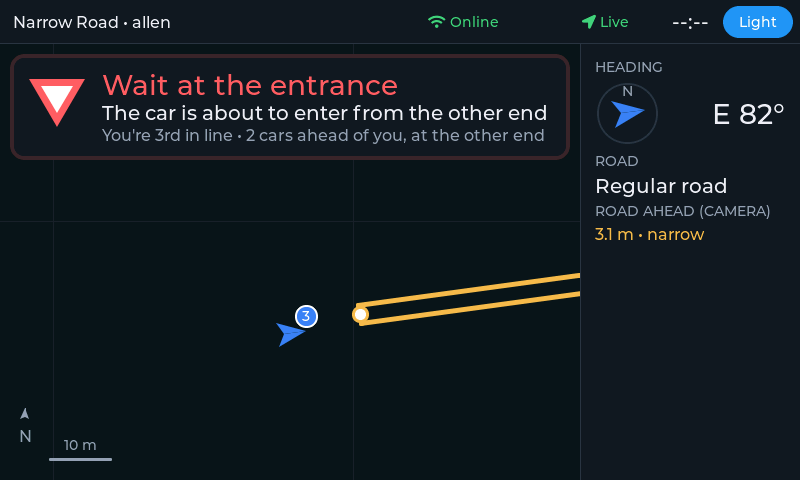

# Narrow Road Navigation: hardware

The car's own hardware for [Narrow Road Navigation](https://github.com/allenchrist/narrow-road-navigation). It replaces the two stand-ins the project uses today:

| Today | In hardware | Folder |
|---|---|---|
| Android app ([VehicleSensorModule](https://github.com/allenchrist/VehicleSensorModule)) | **Main unit**: ESP32, GPS, compass | `main-unit/` |
| Web dashboard | **Display unit**: 5-inch ESP32-S3 touch screen | `display-unit/` |
| (new) | **Camera unit**: measures the road's width | `camera-unit/` |

It talks to the **same server, unchanged**. To the server, the main unit is just another phone, and the screen is just another dashboard. The app and website keep working alongside it.

```
                         In the car
  ┌──────────────────────────────────────────────────────────┐
  │  Camera unit ── road widths (UDP broadcast) ──┐           │
  │  ESP32-CAM, or webcam / phone + width.py      ▼           │
  │                                         Main unit         │
  │                                   ESP32, GPS, compass     │
  │  Display unit (5-inch screen)                 │           │
  └──────────────┬────────────────────────────────┼───────────┘
                 │            Wi-Fi: phone hotspot │
                 └──────────────┬─────────────────┘
                                ▼
                 Server (Render): same as today
```

No wires between the units: all three join the same phone hotspot, and each needs only power.



## How the parts talk

| From → to | How | What |
|---|---|---|
| Main unit → server | `POST /api/auth/login`, `POST /api/auth/device` | Logs in, links this device to the account (as the app does) |
| Main unit → server | WebSocket `/vehicle`, with `Authorization: Bearer` | `register`, then telemetry about once a second and `heading` on turns: the app's exact messages |
| Main unit → server | `POST /api/narrow-road-suggestions` | A narrow road the camera found, for the admin to review |
| Display → server | `POST /api/auth/login`, then Socket.IO | `session:identify`, then `session:assigned` and `vehicles:update`: what the website receives |
| Camera → main unit and display | UDP broadcast, port 4210 | `{"type":"width","width":3.2,"wide":false,"distance":6.0,"confidence":0.8}` |

The main unit and display log in with **the same account**, made in the Android app. Linking the main unit moves that account off any phone that was using it, just as logging in on a new phone does.

## Parts

| Part | What's used | Status | Used for |
|---|---|---|---|
| Main controller | Ordinary **ESP32 DevKit** (ESP32-WROOM-32). An ESP32-S3 DevKitC-1 also works | Have it | Runs the main unit |
| GPS | **NEO-6M** module (any NMEA GPS works) | Have it | Position, speed, direction of travel |
| Heading sensor | **GY-271 compass** (QMC5883L). A BNO085 or BNO055 also works, chosen in `config.h` | Have it | Heading |
| Breadboard, jumper wires | | Have them | Joining it all up without soldering |
| Battery | 4 × 3.7 V Li-ion cells | Have them, but see [Power](#power) | Later: power away from USB |
| Display | 5-inch 800×480 ESP32-S3 board, **ESP32-8048S050** (capacitive touch) | Not bought yet: the website dashboard shows the alerts meanwhile | The car screen |
| Camera | A phone with **IP Webcam** or **DroidCam**, and a laptop running `width.py`. Or an ESP32-CAM | Using the phone | Road width |

A compass measures only direction, not acceleration or rotation, so those are sent to the server as 0. The server and dashboard don't need them.

## Wiring

**Main unit (ordinary ESP32 DevKit).** Plug the ESP32 into the breadboard across the middle gap. It is so wide that only one side's pins get a free hole beside them, so put the side with **3V3, GND, D15 ... D23** on the side with the free holes. Every wire below goes to that side. Run 3V3 to the breadboard's **+** rail and GND to its **−** rail, and power both modules from the rails. Pins are set in `main-unit/include/config.h`.

| Part | Pin on the part | ESP32 pin |
|---|---|---|
| NEO-6M GPS | VCC | 3V3, through the + rail (VIN, 5 V, also works if you can reach it) |
| NEO-6M GPS | GND | GND, through the − rail |
| NEO-6M GPS | TX | GPIO 16 (may be printed RX2) |
| NEO-6M GPS | RX | GPIO 17 (may be printed TX2) |
| GY-271 compass | VCC | 3V3, through the + rail |
| GY-271 compass | GND | GND, through the − rail |
| GY-271 compass | SDA | GPIO 21 |
| GY-271 compass | SCL | GPIO 22 |
| GY-271 compass | DRDY | not used, leave it empty |

TX goes to the other side's RX: the GPS *talks* on its TX, and the ESP32 *listens* on GPIO 16. If the status line says `No data from the GPS`, swap the two wires on GPIO 16 and 17 first.

Keep the compass a hand's width or more from the GPS module and its antenna, the USB cable and anything steel: they all bend the magnetic field it measures.

**Main unit (ESP32-S3 DevKitC-1)**, if you use one instead: pick the `esp32-s3` env in PlatformIO. GPS TX → GPIO 18, GPS RX → GPIO 17, sensor SDA → GPIO 8, SCL → GPIO 9, power from 3V3 and GND as above.

**Display unit.** Nothing to wire: power it through its USB-C port. If yours is a different board, put its pins in `display-unit/include/board.h`; nothing else changes.

**ESP32-CAM.** 5V and GND only. It has no USB port: upload through an ESP32-CAM-MB board (it plugs underneath), or a USB-serial adapter with GPIO 0 joined to GND while it resets.

## Power

**For now, power the ESP32 from USB only**: the laptop, a phone charger, or a USB power bank (a power bank is the easy way to take it into the car or outdoors). USB also powers the GPS and compass, through the ESP32's 3V3 pin. Nothing else is needed.

**The four Li-ion cells: don't connect them yet.** Without a charger and protection board they are not safe to use:

- **Never** join a cell straight to 3V3 (a full cell is 4.2 V; that pin takes at most 3.6 V) or to VIN (3.7 V is too little for the ESP32's regulator, so it resets at random).
- **Never** wire the four in series (up to 16.8 V). It can burn out the ESP32's regulator.
- Don't short a cell's ends, and don't charge them on anything not made for Li-ion.

**The safe one-cell setup, later.** Buy two cheap modules (together about ₹100 to ₹150):

```
one cell ── TP4056 charger board ── MT3608 boost board ── ESP32 VIN and GND
            (with protection,       (set to 5.0 V)
             USB-C)
```

1. **TP4056 with protection** (it has a second small chip, DW01, and pins marked B+ B− OUT+ OUT−). The cell goes on B+ and B−, with red to B+. It charges the cell from USB and cuts off before the cell is run too flat.
2. **MT3608 boost** from OUT+ and OUT−. **Before** joining it to the ESP32, turn its little screw while measuring its output with a multimeter until it reads **5.0 V**. New boards often come set much higher.
3. Its output goes to the ESP32's **VIN** and **GND**.
4. Don't plug in USB while the battery is connected. Unplug the battery to upload code.

Use one cell, in a proper 18650 holder, rather than loose cells held with tape. Keep the other three for spares.

**In the car, later.** 12 V socket → fuse → buck converter → 5 V to each unit. A car's "12 V" swings from 9 to 16 V with spikes when the engine starts, so use an automotive-rated converter. A USB car charger is the simplest version of this.

## Setting up

**New to hardware?** Follow [docs/BUILD_GUIDE.md](docs/BUILD_GUIDE.md): every step from wiring the breadboard to the car on the live map.

You need [VS Code](https://code.visualstudio.com) with the **PlatformIO** extension, and the phone hotspot on.

For **each** of `main-unit`, `display-unit` and `camera-unit/esp32-cam`:

1. Copy `include/secrets.example.h` to `include/secrets.h` and fill in the hotspot name and password (and, for the main unit and display, the account's username and password). `secrets.h` is never uploaded to GitHub.
2. Open the folder in VS Code (File > Open Folder). PlatformIO downloads everything it needs the first time.
3. Connect the board by USB, then **Upload** and **Monitor** in the PlatformIO sidebar.

The first build downloads the ESP32 tools and takes several minutes.

For the main unit, the PlatformIO sidebar shows two boards: **esp32dev** is the ordinary ESP32 (the default), **esp32-s3** the S3. Use Upload under the one you have.

If Upload says it can't find the board: try another USB cable (many are charge-only), install the USB driver for the chip printed next to the ESP32's USB port (CP2102 or CH340), and if it still waits at `Connecting...`, hold the **BOOT** button until uploading starts.

Everything you might change is in each unit's `include/config.h`: the server address, pins, which heading sensor, timings, and the narrow-road rules. To use a server on your laptop instead of Render, set `SERVER_USE_TLS 0`, `SERVER_HOST` to the laptop's address on the hotspot, and `SERVER_PORT 5000`.

### What you should see

**Main unit**, in the serial monitor every 5 seconds:

```
[Server] Logged in as allen
[Server] Device esp32-a1b2c3d4e5f6 linked to allen
[Server] Registered as VEHICLE_004
[Status] server: connected VEHICLE_004 | GPS: fix, 9 sats, 51234 chars | IMU: QMC5883L ok, heading 87 (raw 124) | camera: 3.2 m, 0s ago
```

The car appears on the admin page's Live map, like a phone. The NEO-6M needs open sky (outdoors, not by a window) the first time, and can take 2 to 5 minutes to get a fix. Its small LED starts blinking once it has one. `chars` going up means the ESP32 is hearing the GPS, fix or not.

**Display**: "Waiting for the main unit to connect" until the main unit is sending, then the map and alerts. Until the screen is bought, open the website dashboard on the phone or laptop with the same account.

**ESP32-CAM**: it prints its address. Open `http://that-address/` in a browser on the hotspot to see the road width live, and the picture with what it measured marked.

### Calibrating the heading

You do this by typing commands in PlatformIO's serial monitor (click in it, type, press Enter). What you set is saved on the ESP32 and kept through power-offs and new uploads.

| Command | What it does |
|---|---|
| `cal` | Calibrates the compass. Turn it slowly round, flat, for 30 seconds |
| `north` | Says "the car is pointing north right now" |
| `reverse` | Flips the direction, if the heading goes down when turning right |
| `reset` | Forgets everything saved |
| `watch` | Shows the heading 5 times a second as you turn it; press Enter to stop |
| `help` | Lists these |

1. **`cal`.** Mount the compass where it will stay, on the breadboard, flat. Type `cal`, then slowly turn the whole breadboard round two or three full circles, keeping it flat, away from laptops, phones and metal tables. It prints the X and Y ranges as you go. When the 30 seconds are up it says `Done and saved`, or tells you to try again if it wasn't turned all the way round. Do this again if you move the compass, or once it is in the car.
2. **`north`.** Point the car (or the arrow printed on the GY-271) north, using a phone compass app, and type `north`. The status line should now say `heading 0`.
3. **Check with a right turn.** Turn right a quarter circle: it should say about 90 (east). If it goes down instead (about 270), type `reverse`.

Why calibrate: magnets and steel near the sensor (the GPS, the car body, wires) shift its readings. `cal` measures that shift and takes it out.

**When moving faster than 7 km/h** (2 m/s, set by `GPS_COURSE_MIN_SPEED_MPS`), the main unit uses the GPS's direction of travel instead, and the status line says `using GPS course`. That is more accurate while driving, because a car's own steel pulls a compass off. The compass covers when the car is stopped or slow, such as waiting at a narrow road's entrance. Without any sensor, it uses only the GPS direction.

## The camera

### How it measures

The camera looks at the road ahead. After calibration, it knows which pixel row shows the ground 5, 6 and 7 m ahead, and how many metres each pixel spans there. On each of those rows it starts at the road straight ahead, scans left and right until the picture stops looking like that road (a wall, kerb or verge), and turns the two edges into metres. The reading is the middle one of the three, smoothed over the last five pictures.

If a scan reaches the edge of the picture without finding a side, the road is wider than the camera sees, and it says "wide": certainly not narrow.

The main unit places each reading on the map a few metres ahead of the car. When readings say 4 m or less along at least 25 m (70% of the readings), the same rules the server's `findNarrowRoads.js` uses, it sends that stretch as a suggestion. The admin approves or rejects it as usual. A road it has already sent isn't sent again.

The screen also shows the latest reading under **Road ahead (camera)**.

### Choosing a camera

| Camera | How | Notes |
|---|---|---|
| **ESP32-CAM, measure mode** (default) | Measures on the ESP32-CAM itself | Cheapest, nothing else needed. Simple method, so bright sun and deep shadow can confuse it |
| **ESP32-CAM, stream mode** | Sends video; `width.py` on a laptop measures | Set `CAMERA_MODE_STREAM` in its `config.h`. Use `--source http://CAMERA:81/stream` |
| **USB webcam** | `width.py --source 0` on a laptop or Raspberry Pi | Easy to try at home first |
| **Phone camera** | `width.py` with the phone's video stream | Install **IP Webcam** (Android): `http://PHONE:8080/video`, or **DroidCam** (Android/iPhone): `http://PHONE:4747/video`. The app shows the address |

Whichever you use, it broadcasts the same message, so the main unit and screen don't care which.

`width.py` needs Python 3.10 or newer: `pip install -r camera-unit/python/requirements.txt`. The laptop or Pi must be on the same hotspot.

### Mounting and calibrating

Mount the camera firmly, centred, looking straight ahead and slightly down, so the road 4 to 8 m ahead is in the lower half of the picture. If it moves, calibrate again.

1. On flat ground, put four markers (stones, tape or chalk crosses) at the corners of a rectangle centred on the car's line: **2 m wide, from 4 m to 8 m ahead** of the camera, measured along the ground from directly below it.
2. Run, from `camera-unit/python`:
   ```
   python calibrate.py --source http://CAMERA-ADDRESS/frame.bmp     # ESP32-CAM
   python calibrate.py --source 0                                    # USB webcam
   python calibrate.py --source http://PHONE:8080/video              # phone
   ```
3. Click the markers in order: near-left, near-right, far-right, far-left. Press Enter.
4. It saves `calibration.json` (used by `width.py`) and prints a line like `#define CAM_IMAGE_TO_GROUND {...}`. For the ESP32-CAM, paste it over the one in `camera-unit/esp32-cam/include/config.h` and upload again.

Check it: stand in a lane, measure its width with a tape, and compare with the reading. Measuring 10 to 15 real lanes like this gives you an accuracy figure for the project report.

`calibrate.py --help` also shows how to calibrate without a window, or roughly from the camera's height and tilt without markers.

## Testing without the hardware

| What | How | Needs |
|---|---|---|
| Your server accepts the hardware's messages | `python tools/protocol_check.py --server https://YOUR-SERVER --username you --password ...` | `pip install websocket-client`. Moves that account to a test device |
| Narrow-road finding (main unit) | `g++ -std=c++17 -Imain-unit/src main-unit/host-tests/test_narrow_detector.cpp main-unit/src/narrow_detector.cpp -o t && ./t` | g++ |
| Compass calibration and heading corrections (main unit) | `g++ -std=c++17 -Imain-unit/src main-unit/host-tests/test_heading_math.cpp main-unit/src/heading_math.cpp -o h && ./h` | g++ |
| The screen reads the server's messages, worded like the website | See the top of `display-unit/host-tests/test_display_logic.cpp` | g++, ArduinoJson (PlatformIO downloads it) |
| Preview the screen on your laptop | `display-unit/host-tests/preview/preview.sh` | g++, after one PlatformIO build of the display |
| Camera width on synthetic lanes | `python camera-unit/python/tests/test_width.py` | numpy, opencv-python |
| ESP32-CAM's C++ gives the same answers as Python | See the top of `camera-unit/esp32-cam/host-tests/test_width_core.cpp` | g++, Python |
| Try `width.py` on a photo | `python camera-unit/python/width.py --source lane.jpg` | A photo of a lane, after calibrating |

GitHub runs the firmware builds and these tests on every push (`.github/workflows/checks.yml`).

## What was checked, and what wasn't

Checked before this was handed over:

- All three firmwares **compile** for their boards (Arduino core 3.0.7): the main unit for the ordinary ESP32 and the ESP32-S3, with each heading sensor choice; both camera modes.
- The compass calibration and the `north` and `reverse` corrections were tested on simulated compass readings (a shifted, squashed circle comes back within a degree; part turns are rejected).
- `tools/protocol_check.py` passed **15 of 15** against the real server code with a temporary database and `REQUIRE_VEHICLE_TOKEN` on: login, device link, register, telemetry, headings, the Socket.IO session, the road outline reaching the screen, a suggestion, and both refusal messages the firmware looks for.
- The screen's reading of `vehicles:update` was tested on **real messages recorded from the server** while its own simulators drove through 14 of the 15 alerts. Its wording matched what the website's `NarrowRoadAlert` component shows for the same messages, word for word.
- The camera measured synthetic lanes of 2.5 to 6 m to within 9 cm, and the ESP32-CAM's C++ gives the same answer as Python on every test picture.
- The screen layouts in `docs/screens/` were drawn by the real screen code from those recorded messages.

Not checked, because it needs the physical parts:

- **The display's pins** come from the graphics library's own example for the 4.3-inch ESP32-8048S043, which uses the same pins as the 5-inch board. If the screen stays dark or shows noise, compare `board.h` with the seller's demo code. If taps land in the wrong corner, change `TOUCH_ROTATION`.
- **Nothing has run on the real ESP32, GPS or compass yet.** The compass driver follows each chip's datasheet; which of the three chips your GY-271 has shows in the first lines the main unit prints.
- **The heading's direction** depends on how the sensor is mounted, which is why `north` and `reverse` are setup steps.
- **Real roads**: lighting, shadows and parked vehicles will make the camera less accurate than on synthetic pictures. Test in real lanes and report the accuracy you measure.

## Limits

- **The phone hotspot must stay on** while driving. Some phones turn the hotspot off when nothing is using it; turn that setting off.
- **Same limits as the app**: GPS error, only vehicles using the system count, alerts are advice only. See the main project's README.
- **Camera**: one camera can't see through parked vehicles or round bends, and a lane edged by open ground rather than walls is harder to measure.
- **The screen's map** draws roads and vehicles on a plain background. There are no street tiles.
- **No sound**: danger alerts flash their border instead.

## Folders

```
main-unit/                 ESP32 / ESP32-S3 firmware (PlatformIO)
  include/config.h         server, pins, heading sensor, narrow-road rules
  src/compass.cpp          GY-271 driver (QMC5883L, QMC5883P, HMC5883L)
  src/imu_reader.cpp       heading from the chosen sensor; saved corrections
  src/heading_math.cpp     compass calibration and north/reverse arithmetic
  src/server_link.cpp      login, device link, /vehicle WebSocket, suggestions
  src/narrow_detector.cpp  camera widths + GPS → narrow-road suggestions
  host-tests/              tests that run on a laptop
display-unit/              5-inch screen firmware (PlatformIO, LVGL)
  include/board.h          the board's pins
  src/server_session.cpp   login and Socket.IO, as the website does
  src/alert_text.cpp       each alert's words, ported from the website
  src/ui.cpp               the screen: map, alert card, side panel
  lib/WebSockets/          arduinoWebSockets with its message limit raised
  host-tests/              tests on recorded server messages; screen preview
camera-unit/
  esp32-cam/               ESP32-CAM firmware (PlatformIO)
  python/                  width.py, calibrate.py for webcams and phones
tools/protocol_check.py    checks a server accepts the hardware's messages
docs/screens/              the screen, drawn from recorded server messages
```

**Libraries**: ArduinoJson, arduinoWebSockets (LGPL 2.1, local copy in `display-unit/lib`), TinyGPSPlus, Adafruit BNO08x and BNO055, LVGL, GFX Library for Arduino, TAMC_GT911, OpenCV.
